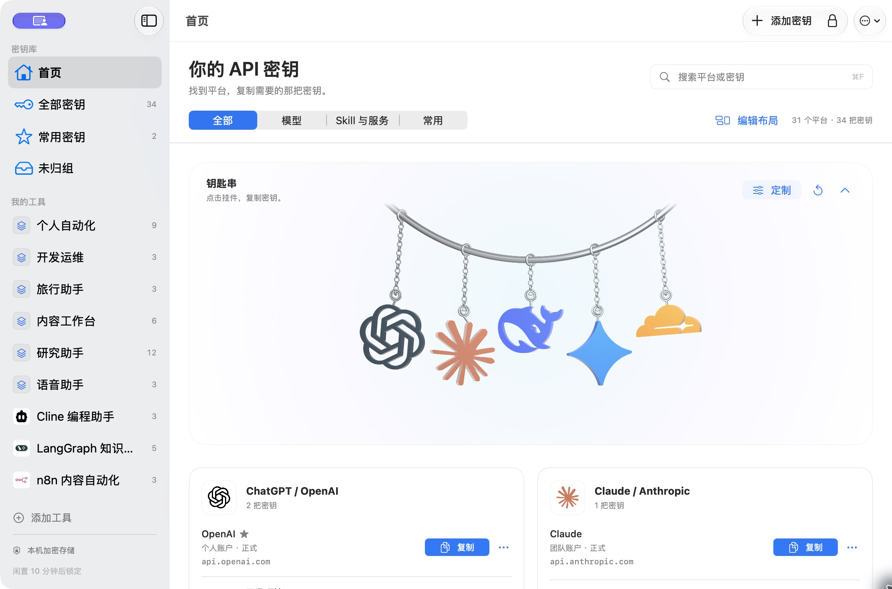
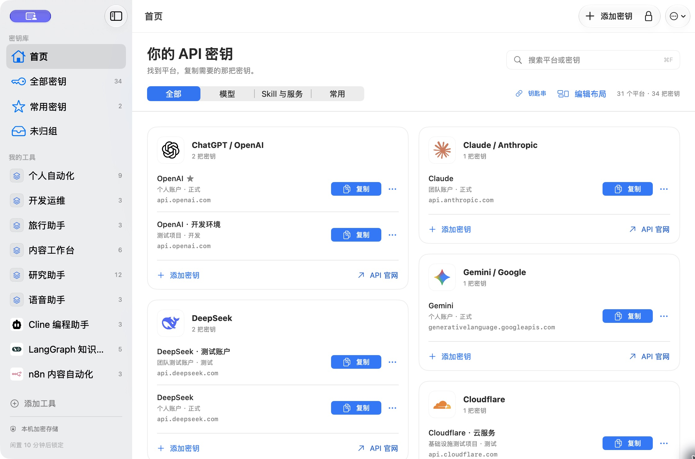
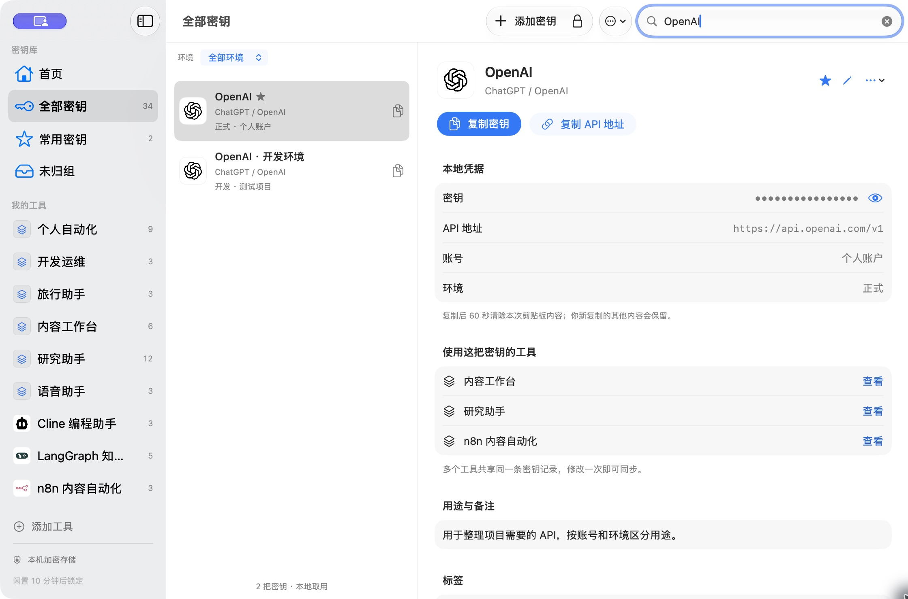
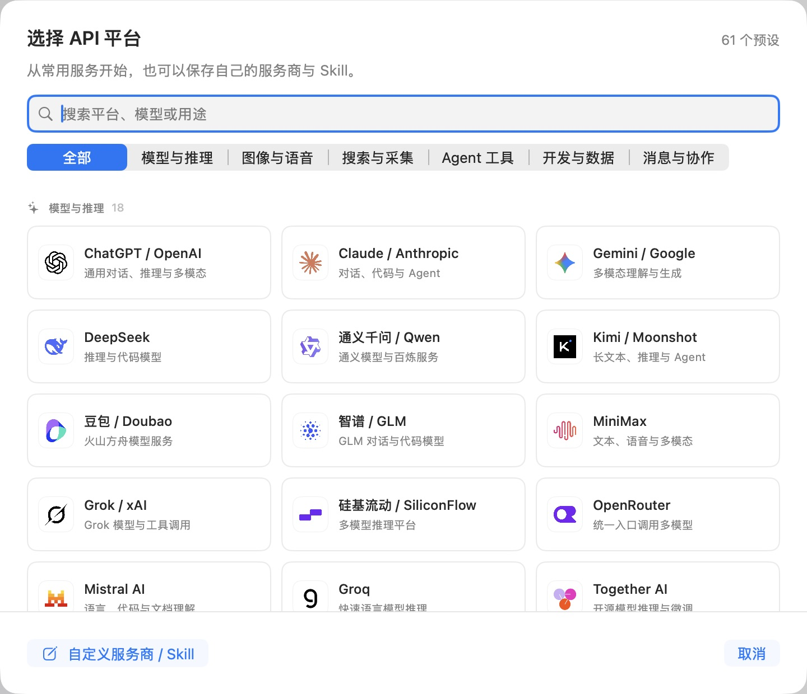
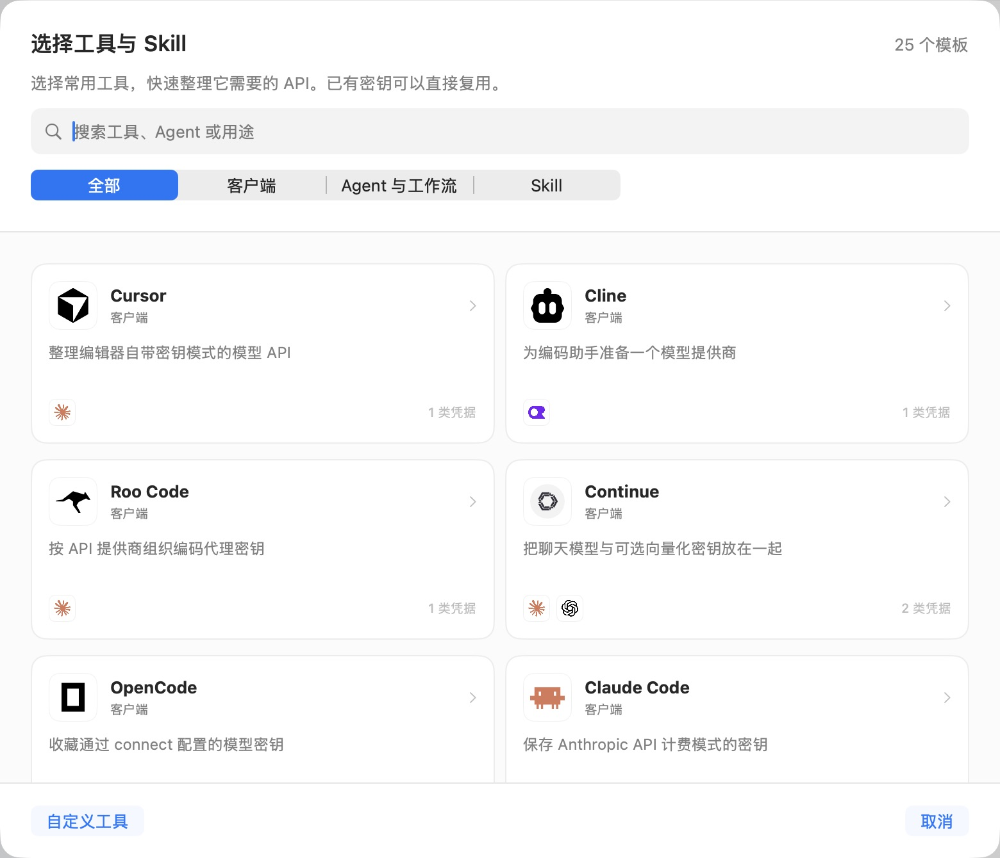
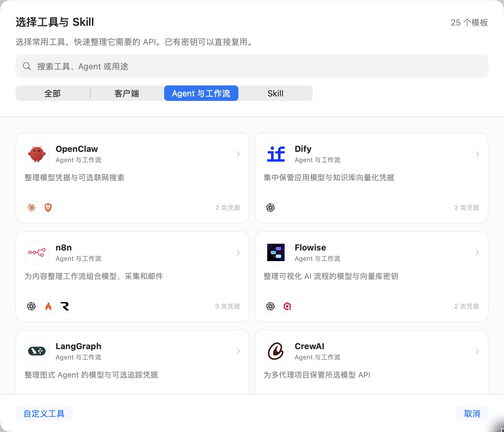
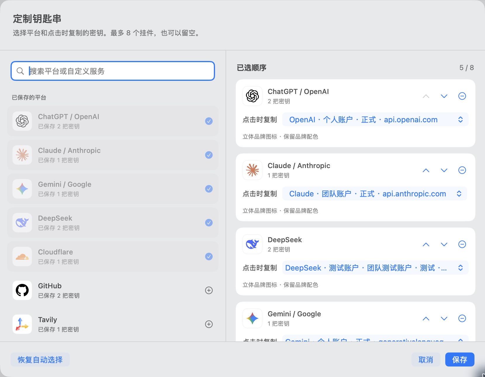
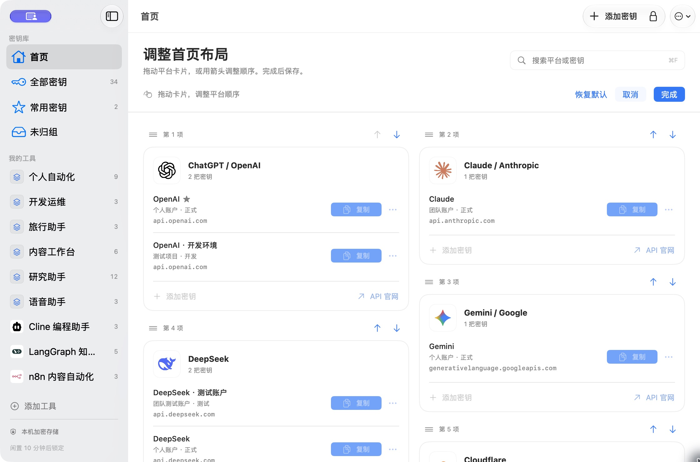

<p align="center">
  
</p>
<h1 align="center">Keynest</h1>
<p align="center"><strong>把散落在各个平台的 API 密钥，收进你的 Mac。</strong></p>
<p align="center">本地加密保存 · Touch ID 解锁 · 找到平台，直接复制</p>

<p align="center">
  <a href="https://github.com/kody1126/Keynest/releases/tag/v0.11.1"></a>
  
  <a href="https://github.com/kody1126/Keynest/actions/workflows/checks.yml"></a>
  <a href="LICENSE"></a>
</p>

<p align="center">
  <strong><a href="https://github.com/kody1126/Keynest/releases/download/v0.11.1/Keynest-0.11.1-arm64-r1.dmg">下载 macOS 版</a></strong>
  · <a href="README.en.md">English</a>
  · <a href="macos/README.md">使用文档</a>
  · <a href="https://github.com/kody1126/Keynest/issues">反馈问题</a>
</p>

<p align="center">适用于 Apple Silicon · 当前界面为中文 · 免费开源</p>

<p align="center">
  <a href="docs/images/keyring.png"></a>
</p>
<p align="center"><sub>Keynest 0.11.1 · 点击挂件，取用常用密钥。</sub></p>

一个模型平台有几把 Key，一个 Agent 又需要搜索、浏览器和数据库。Keynest 把这些凭据收进同一个本地密钥库：保存一次，下次打开就能找到。

<p align="center">
  <a href="#打开首页找到就能复制">首页取用</a> ·
  <a href="#同一平台多把密钥也分得清">多密钥管理</a> ·
  <a href="#常用平台选好再粘贴">平台预设</a> ·
  <a href="#按工具整理一组密钥">工具与 Skill</a> ·
  <a href="#把常用入口摆成自己的样子">个性化布局</a>
</p>

## 打开首页，找到就能复制

按平台展示密钥，卡片随内容高度紧凑排列。搜索名称、平台、账号或环境，或者切换到「常用」，直接复制需要的那一把。钥匙串可以收起，为更多平台留出空间。

<p align="center">
  <a href="docs/images/home.png"></a>
</p>

## 同一平台，多把密钥也分得清

个人账号、团队账号、开发环境、正式环境可以分别保存。详情页把 **密钥、API 地址、账号、环境和使用它的工具**放在一起；无需显示密钥正文，也能完成复制。一条记录可以关联多个工具，更新时不用逐个修改副本。

<p align="center">
  <a href="docs/images/key-details.png"></a>
</p>

## 常用平台，选好再粘贴

内置 **61 个平台预设**，从模型推理、图像语音，到搜索采集、Agent 工具、开发数据和消息协作。每个预设附品牌图标与官方 API 入口；选择平台后保存自己的密钥，也可以填写自定义服务商。

<p align="center">
  <a href="docs/images/providers.png"></a>
</p>

[查看完整平台目录与官方来源](research/api-catalog-0.7.md)

## 按工具整理一组密钥

内置 **25 个工具与 Skill 模板**，覆盖 Cursor、Cline、Claude Code、Dify、n8n、LangGraph 等。为一个工具复用已有密钥，或补上它需要的新密钥；以后从侧栏进入这个工具，就能找到相关凭据。

<table>
  <tr>
    <th width="50%">客户端与编程工具</th>
    <th width="50%">Agent 与工作流</th>
  </tr>
  <tr>
    <td><a href="docs/images/tool-templates.png"></a></td>
    <td><a href="docs/images/agent-templates.png"></a></td>
  </tr>
</table>

Keynest 负责保存和关联凭据，不会自动修改外部工具的配置。[查看工具与 Skill 模板](research/skill-agent-templates-0.7.md)

## 把常用入口摆成自己的样子

为钥匙串选择最多 **8 个挂件**，指定点击时复制的那把密钥；同平台有多个账号时，也能固定常用的一个。首页支持拖动整张平台卡片调整顺序，也可以用前移、后移按钮，最后选择保存、取消或恢复默认。

<table>
  <tr>
    <th width="50%">选挂件，也选它对应的密钥</th>
    <th width="50%">按使用习惯排列首页</th>
  </tr>
  <tr>
    <td><a href="docs/images/keyring-customize.png"></a></td>
    <td><a href="docs/images/home-layout.png"></a></td>
  </tr>
</table>

钥匙串在本机渲染，只接收平台名称、图标和颜色等展示信息，不持有密钥正文。挂件绑定和首页顺序随密钥库加密保存，并包含在加密备份里；支持系统的「减少动态效果」和「减少透明度」。

## 下载与开始使用

**[下载 Keynest 0.11.1 · Apple Silicon](https://github.com/kody1126/Keynest/releases/download/v0.11.1/Keynest-0.11.1-arm64-r1.dmg)** · [发布说明与 SHA-256 校验文件](https://github.com/kody1126/Keynest/releases/tag/v0.11.1)

公开安装包只包含 `Keynest.app`。`r1` 为打包修订，详见发布说明。

需要 **macOS 14 或更新版本**。当前提供 Apple Silicon 安装包；Intel Mac 可尝试从源码构建，但尚未验证。

1. 打开 DMG，将 `Keynest.app` 复制到个人的 `~/Applications` 文件夹，再打开安装后的 App。
2. 设置至少 12 个字符的主密码；支持 Touch ID 时可选择启用指纹解锁。
3. 在首页选择平台，粘贴自己的 API Key，保存。下次点击卡片上的「复制」，或点击已选定密钥的挂件直接复制。

> [!IMPORTANT]
> 当前是预览版，采用本地 ad-hoc 签名，尚未使用 Apple Developer ID 签名或公证，首次打开可能被 macOS 拦截。请从本仓库下载，或从源码构建；首次打开可参考 [Apple 官方说明](https://support.apple.com/zh-cn/102445)。主密码无法找回，请妥善保存并定期导出加密备份。

## 本地保存，安全边界说清楚

密钥库整体使用 **AES-256-GCM** 加密，主密码通过 **PBKDF2-HMAC-SHA256**（600,000 次迭代、随机盐）派生加密密钥。Touch ID 的解锁能力由 Apple Secure Enclave 保护。

- 支持的 Mac 可使用 Touch ID 解锁，主密码始终可作备用。
- 不需要云端账户，不主动上传或同步密钥库。
- 支持导出本地加密备份，也能将备份中的条目合并到现有密钥库。
- 闲置 10 分钟或系统休眠后自动锁定。
- 复制时禁用通用剪贴板同步；60 秒后清除本次复制内容，不覆盖后来复制的其他内容。第三方剪贴板工具仍可能保存副本。
- 额度查询需主动开启并手动刷新。目前支持 DeepSeek、硅基流动和 OpenRouter 的部分余额或用量信息，**不提供全平台实时额度同步**。

本项目尚未经过独立安全审计。磁盘加密不能保证电脑已被恶意软件控制时，解锁中的内存、屏幕或剪贴板仍然安全。

[安全机制与限制](macos/README.md#安全边界) · [0.8.1 检查记录](research/security-review-0.8.1.md) · [私下报告漏洞](SECURITY.md)

## 从源码构建

> **源码进展：** `main` 包含 0.12.0 候选版的实时卡片让位与精修 Blender 挂件，最终原生界面验收尚未完成。上方截图及可下载安装包均为 0.11.1。[验证记录](macos/verification.md) · [模型预览与源文件](macos/Resources/KeychainArt/README.md)

原生 App 使用 SwiftUI / AppKit，首页钥匙串使用 SceneKit 本地渲染，没有第三方 Swift Package 依赖。需要 macOS 和 Apple Command Line Tools；不需要 Node.js、完整 Xcode 或 Blender。Blender 只用于开发时重建已随项目提供的 [立体资源](macos/Resources/KeychainArt/README.md)。

```sh
git clone https://github.com/kody1126/Keynest.git
cd Keynest/macos
zsh scripts/build-app.sh
zsh scripts/install-apps.sh
```

默认只构建和安装正式 App。安装脚本会校验并备份已有 App，不会改动密钥库。构建产物位于 `macos/dist/apps.noindex/`；请运行安装后的副本。

[完整构建与打包说明](macos/README.md#从源码构建) · [测试与贡献指南](CONTRIBUTING.md) · [更多文档](docs/README.md)

## 参与这个项目

欢迎提交使用反馈、Bug 和 Pull Request。请先看 [贡献指南](CONTRIBUTING.md)；公开 Issue、截图和日志中不要包含真实密钥或密钥库。安全问题请通过 [私密漏洞报告入口](https://github.com/kody1126/Keynest/security/advisories/new) 提交。

## 许可证

Keynest 原创代码采用 [MIT License](LICENSE)。第三方品牌图标保留各自的许可及商标权利，部分官网素材未附独立开源授权，不在本项目 MIT 授权范围内。详见 [第三方声明](THIRD_PARTY_NOTICES.md)。
